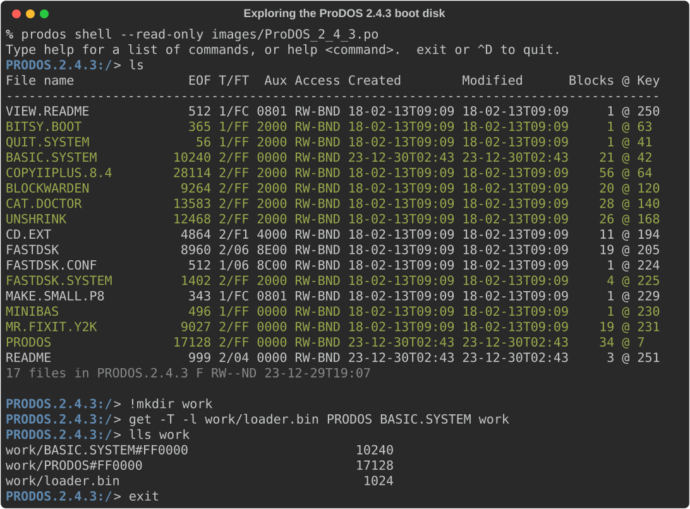
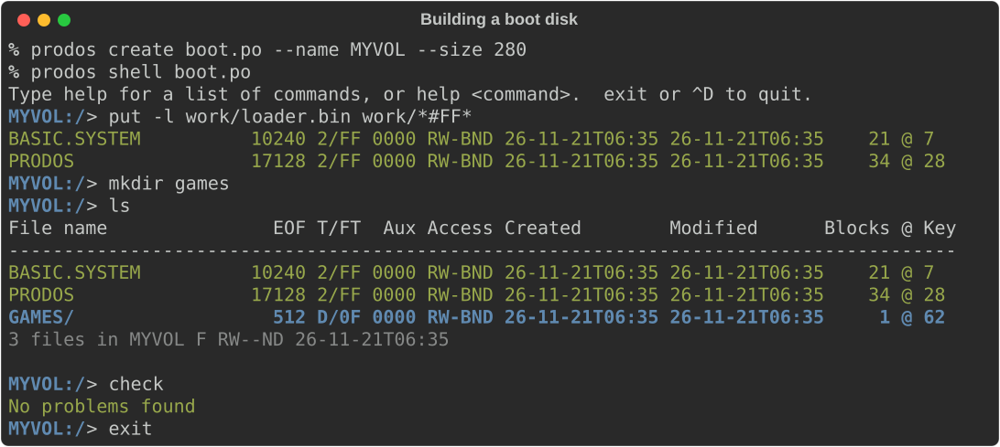

pyprodos
---

This is a simple Python implementation of the Apple ProDOS :tm: filesystem based on the
[technical reference manual](https://prodos8.com/docs/techref/file-organization/).

It provides a simple unix-style CLI for managing existing ProDOS images in 
`.po` and `.2mg` files and for creating new ones.
This provides an accessible file system for Apple // or other 8-bit hardware.

Install it from PyPI:

    % pip install pyprodos
    % prodos --help

Commands
---

| Command | Does |
|---|---|
| `create` | Create an empty `.po` or `.2mg` volume |
| `info` | Show volume details, and with `--map` a picture of block usage |
| `check` | Validate the volume's structure |
| `ls` | List files and directories, optionally `--recursive` |
| `cat` | Show text files |
| `cp`, `mv`, `rm` | Copy, move/rename and remove files on the volume |
| `mkdir`, `rmdir` | Create and remove directories |
| `chinfo` | Change a file's type, aux type or access flags |
| `import`, `export` | Copy files (or the boot loader) between the host and the volume |
| `shell` | Mount a volume and work on it interactively |

Paths on the volume are case-insensitive, start with `/` and can use wildcards like `/SYSTEM/*.SYSTEM`.
Commands that change a volume accept `--output copy.po` to write the result to a copy instead,
and every command accepts `--log access.log` to record each block it reads and writes.

Example: a boot disk
---

As an example, let's recreate a ProDOS boot volume.  Grab the ProDOS 2.4.3
boot disk from https://prodos8.com/.  (There's a copy in `images/` here.)
`prodos shell` mounts it, a bit like `sftp`, so we can look around and copy out
the `PRODOS` o/s, `BASIC.SYSTEM` and the boot loader.  `get -T` keeps each
file's type in its host name, and `-l` saves the loader blocks:

Now we make a new 140K (280 block) floppy, mount it, and put the files and loader on it.
After it boots, ProDOS runs the first `.SYSTEM` file it finds:

Finally, test the image in your favorite emulator.  I used [VirtualII](https://www.virtualii.com/) and popped my volume in the virtual Disk ][ drive.   After a ProDOS splash screen, you see the familiar Basic prompt:

                PRODOS BASIC 1.7
            COPYRIGHT APPLE  1983-92

    ]

The same steps work as one-shot commands, which is handy in scripts and makefiles:

    % prodos export --typed images/ProDOS_2_4_3.po /PRODOS /BASIC.SYSTEM work --loader work/loader.bin
    % prodos create boot.po --name MYVOL --size 280
    % prodos import boot.po --loader work/loader.bin work/*#FF* /

File types
---

Files imported from the host get type SYS (`$FF`) if they're named `PRODOS` or
`*.SYSTEM`, which is what ProDOS needs to boot them, and BIN (`$06`) otherwise.
Use `--type` and `--aux` to set them explicitly, e.g. a text file or a binary with
its load address.  The type can be a name (`TXT`, `BIN`, `BAS`, `SYS`) or hex:

    % prodos import boot.po --type TXT notes.txt /NOTES
    % prodos import boot.po --type 06 --aux 2000 game.bin /GAME

Host file names can also carry the type, using the CiderPress / AppleCommander
convention `NAME#TTAAAA` (file type and aux type in hex).  `export --typed` writes
names like that, and `import` always reads them, so types survive a round trip:

    % prodos export --typed boot.po /GAME .         # writes GAME#062000
    % prodos import other.po GAME#062000 /

`cp` and `mv` preserve each file's type, aux type and dates, and `chinfo` changes them later:

    % prodos chinfo boot.po /GAME --aux 0800 --access RWBND

Interactive shell
---

In `prodos shell` the ProDOS commands (`ls`, `cd`, `cat`, `cp`, `mv`, `rm`, `mkdir`,
`rmdir`, `chinfo`, `info`, `check`) work on the volume with paths relative to the
current directory.  `lcd`, `lls` and `!command` work on the host, and `put`/`get`
copy files between the two:

| Shell | Does |
|---|---|
| `put FILE...` | Copy host files into the current directory |
| `put FILE... DST` | Copy host files to DST (a directory, or a new name for one file) |
| `get PATH... [HOSTDST]` | Copy files to the host's current directory, or HOSTDST |
| `-r` | With `put`/`get`, copy whole directory trees |
| `-T` | With `get`, add `#TTAAAA` type suffixes to host names |
| `-l FILE` | With `put`/`get`, write or save the boot loader |

Tab completes ProDOS paths, and command history is saved in `~/.prodos_history`.
Type `help` for all the commands.  Use `--read-only` to explore without risk,
or `--output copy.po` to work on a copy.

Checking a volume
---

Use `check` to validate a volume's structure: directory back pointers, block
counts, cross-linked blocks and the volume bit map:

    % prodos check boot.po
    No problems found

How the code is organized
---

The code mirrors the [technical reference](https://prodos8.com/docs/techref/file-organization/),
using one name per concept where the spec overloads "directory", "entry" and "header":

| Module | Concept |
|---|---|
| `device.py` | `BlockDevice`: a `.po` or `.2mg` image as numbered 512-byte blocks, with an access log |
| `bitmap.py` | `Bitmap`: the volume bit map recording free blocks |
| `blocks.py` | Block formats: directory, index, bit map and extended key blocks |
| `metadata.py` | Directory records: `VolumeDirectoryHeader`, `SubdirectoryHeader`, `FileEntry` (and a glossary) |
| `file.py` | `Fork`: bytes stored as a seedling, sapling or tree; `File`: an entry plus its fork(s) |
| `directory.py` | `Directory`: a chain of blocks holding a header and fixed entry slots |
| `volume.py` | `Volume`: loader, volume directory and bit map; paths and the operations on them |
| `check.py` | The invariants of a well-formed volume |
| `host.py` | Moving files between the host and a volume, and `NAME#TTAAAA` names |
| `cli.py`, `shell.py` | The command line and the interactive shell, thin wrappers over the above |

The README screenshots are recorded from real shell sessions by `docs/screenshots.py`.

Development
---

The project uses [uv](https://docs.astral.sh/uv/).  `uv sync` sets up `.venv` with the dev tools,
then run the same checks as CI:

    % uv run ruff check src tests
    % uv run pyright
    % uv run pytest

The tests use the real disk images in `images/`, and every image a test leaves behind is
checked with `check_volume`.

Background
---

My original goal was to learn how the on-disk representation worked and to manage
disk images for a 6502-based breadboard computer.
ProDOS is simple enough that a minimal kernel
can be very small.  For example I use a read-only
version that's only a couple hundred lines of TaliForth.
I also ported a version of the original 6502
ProDOS filesystem kernel: [p8fs](https://github.com/patricksurry/p8fs).

